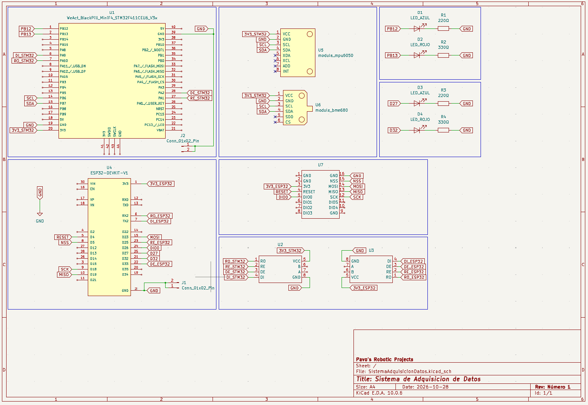
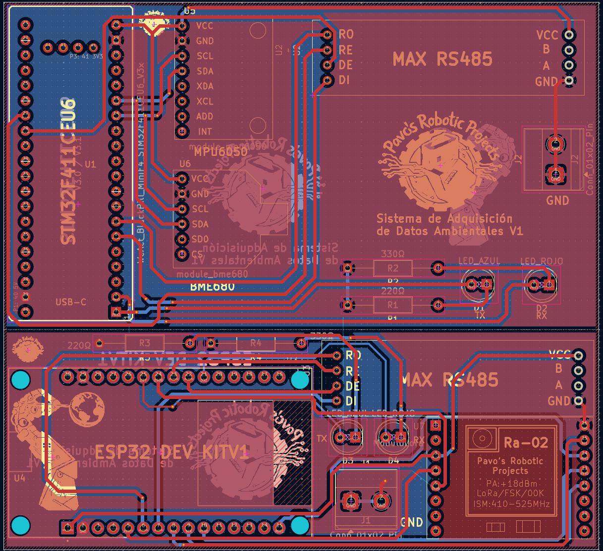
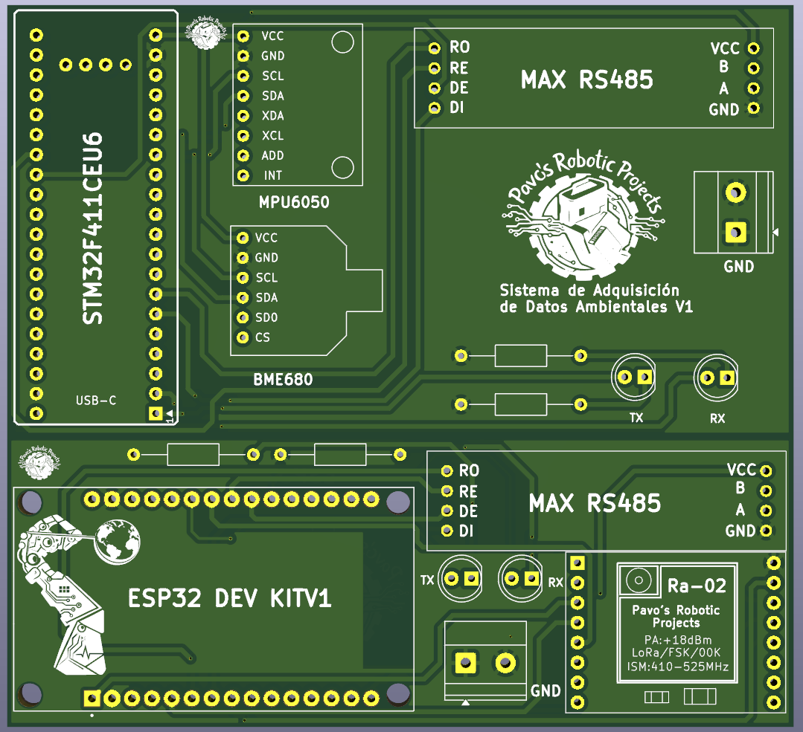

# Sistema ASTRA I: adquisición, telemetría y estación terrena

Sistema embebido de tres nodos para adquirir variables ambientales y de movimiento, protegerlas con CRC-8, transportarlas mediante UART/RS-485 y LoRa, y visualizarlas localmente y en ThingSpeak.

> **Estado:** integración de los tres nodos comprobada por el autor. La publicación a ThingSpeak y la prueba controlada de una trama RS-485 corrupta también fueron verificadas. Las claves de Wi-Fi y ThingSpeak se configuran localmente y no se incluyen en el repositorio.

## Arquitectura

```text
MPU6050 + BME680
       │ I²C1
       ▼
Nodo 1: STM32F411CEU6
       │ UART1 + MAX485 / RS-485, 115200 8N1
       ▼
Nodo 2: ESP32 DevKit V1 + MAX485
       ├── ACK RS-485 al nodo 1
       ├── SPI2 → SX1278 → LoRa 433 MHz
       └── Wi-Fi estación → ThingSpeak (2 canales)
                              │
                       ACK LoRa de retorno
                              │
                              ▼
Nodo 3: ESP32 + SX1278 + TFT ST7789
       ├── TFT vertical, LEDs de enlace/aviso/error
       └── Punto de acceso local + dashboard HTTP/JSON
```

El nodo 2 confirma por RS-485 una trama válida sin esperar el salto LoRa. El nodo 3 devuelve una confirmación LoRa independiente. ThingSpeak se publica en paralelo desde el nodo 2; el dashboard del nodo 3 funciona en la red local del punto de acceso.

## Nodos y carpetas

| Carpeta | Contenido |
|---|---|
| `FirmwareSTM32/SistemaAdquisicionDatos` | Proyecto STM32CubeMX y Keil para el nodo 1. |
| `FirmwareESP32` | Proyecto ESP-IDF 6.1 para el gateway RS-485/LoRa y la publicación ThingSpeak del nodo 2. |
| [`Firmware_EstacionTerrena`](https://github.com/pavolilan2005/EstacionTerrena/tree/main/Firmware_EstacionTerrena) | Firmware ESP-IDF 6.1 del nodo 3, pantalla TFT y servidor web local. Está en el repositorio separado de estación terrena. |
| `PCBs` | Esquemático y diseño KiCad de la PCB que integra los nodos 1 y 2; se separa físicamente en dos módulos. |
| `Gerbers` | Archivos de fabricación exportados de la PCB de nodos 1 y 2. |
| `Anexos` | Imágenes de esquemático, PCB, vistas 3D y diagrama de conexión. |
| `docs` | Especificación de trama y guía de variables para Keil Watch. |

El repositorio [EstacionTerrena](https://github.com/pavolilan2005/EstacionTerrena) contiene el diseño, Gerbers, modelos 3D y firmware del tercer nodo.

## Interfaces y decisiones de hardware

- Nodo 1: MPU6050 y BME680 comparten I²C1 (PB6=SCL, PB7=SDA). El profesor aprobó expresamente esta selección de sensores I²C; el SPI del sistema se utiliza para los SX1278 en los nodos 2 y 3. Esta excepción queda documentada frente al requisito original de sensor SPI en STM32.
- Nodo 1 RS-485: USART1 PA9/PA10, MAX485 DE=PA2 y `/RE`=PA1.
- Nodo 1 indicadores: TX=PB13, RX/ACK=PB12 y heartbeat=PC13, que cambia cada 200 ms.
- Nodo 2 RS-485: UART2 GPIO17/16, DE=GPIO33 y `/RE`=GPIO25.
- Nodo 2 LoRa: SPI2 SCK=18, MISO=19, MOSI=23, NSS=5, RESET=4 y DIO0=26.
- Nodo 3 LoRa: SPI2 SCK=18, MISO=19, MOSI=23, NSS=5, RESET=14 y DIO0=26. La TFT ST7789 comparte el bus y usa CS=15.
- Los dos módulos MAX485 comparten A con A, B con B y GND común. La terminación/polarización depende de la topología física del bus.

### Notas de revisión de las PCB

- La PCB de nodos 1 y 2 contiene ambos módulos y se divide para formar los nodos independientes. En la revisión fabricada se observó una inversión de los indicadores TX/RX; el firmware conserva el mapa lógico acordado (TX PB13, RX PB12) y la placa recibió una corrección manual. Comprueba la continuidad del LED antes de replicar la PCB.
- En la PCB de la estación terrena se detectó un desplazamiento de una posición en las pistas SPI del SX1278. La placa ensamblada requirió corrección manual. Antes de fabricar otra revisión, verifica con el esquemático y multímetro las redes GPIO5→NSS, GPIO23→MOSI, GPIO19→MISO y GPIO18→SCK; SCK no debe ir a DIO5.
- Los archivos de diseño de cada placa son la fuente; los Gerbers son exportaciones. Revisa y vuelve a exportar los Gerbers después de cualquier cambio de PCB.

## Desarrollo electrónico

Los nodos 1 y 2 comparten una PCB que se separa para obtener los dos módulos. La estación terrena usa su propia PCB; sus fuentes editables son los proyectos KiCad y sus vistas se conservan en `Anexos`.

**Esquemático de la PCB de adquisición/gateway:**



**Diseño de PCB:**



**Vista 3D:**



El hardware del nodo 3, sus figuras y el detalle de reparación de sus pistas SPI están documentados en el repositorio [EstacionTerrena](https://github.com/pavolilan2005/EstacionTerrena).

### Versiones documentadas

| Nodo | Firmware |
|---|---:|
| 1 — STM32F411CEU6 | 1.0.4 |
| 2 — ESP32 gateway | 1.0.3 |
| 3 — estación terrena ESP32 | 1.0.16 |
## Trama y validación

Los nodos usan una trama binaria de 32 bytes: sincronía `A5 5A`, versión, tipo, secuencia, banderas, campos de sensores en punto fijo big-endian y CRC-8/ATM. Los datos con signo usan complemento a dos. El CRC cubre los bytes 2–30; sus parámetros son polinomio `0x07`, inicial `0x00`, RefIn/RefOut desactivados y XOR final `0x00`. El ACK es de seis bytes y contiene la secuencia confirmada y su CRC.

La tabla de offsets, las unidades, conversiones, resolución y escalas está en [`FirmwareESP32/PROTOCOLO_BINARIO.md`](FirmwareESP32/PROTOCOLO_BINARIO.md). El nodo 2 descarta las tramas con CRC incorrecto e incrementa su contador; sus dos canales de ThingSpeak publican variables, CRC recibido/calculado y diagnóstico. El mapa exacto de campos y las instrucciones de credenciales están en [`FirmwareESP32/README.md`](FirmwareESP32/README.md).

## ThingSpeak y credenciales

El nodo 2 se conecta en modo estación a una red Wi-Fi y publica dos canales cada 16 s. Para habilitarlo, copia `FirmwareESP32/main/cloud_secrets.h.example` como `FirmwareESP32/main/cloud_secrets.h` y completa localmente el SSID, la contraseña y las dos Write API Keys. `cloud_secrets.h` está excluido de Git. Nunca pegues las claves en el README ni en el código versionado.

El nodo 3 ofrece además un AP local para supervisar la recepción LoRa. Su SSID, credencial de laboratorio y endpoints se describen en el README de su firmware; cambia la contraseña antes de desplegarlo fuera del laboratorio.

## Compilar y cargar

### Nodo 1 — STM32F411CEU6

1. Abre `FirmwareSTM32/SistemaAdquisicionDatos/SistemaAdquisicionDatos.ioc` con STM32CubeMX para consultar la configuración.
2. Abre `FirmwareSTM32/SistemaAdquisicionDatos/MDK-ARM/SistemaAdquisicionDatos.uvprojx` en Keil MDK-ARM.
3. Selecciona el target `SistemaAdquisicionDatos`, compila y carga con ST-Link.

La guía de STM32CubeMX/Keil, las variables de Watch y la prueba controlada CRC están en [`FirmwareSTM32/SistemaAdquisicionDatos/README.md`](FirmwareSTM32/SistemaAdquisicionDatos/README.md). Las pruebas funcionales están resumidas en [`docs/VALIDACION.md`](docs/VALIDACION.md).

### Nodo 2 — ESP32

Con ESP-IDF 6.1 configurado en VS Code o terminal:

```powershell
cd FirmwareESP32
idf.py set-target esp32
idf.py build
idf.py -p COMx flash monitor
```

### Nodo 3 — estación terrena ESP32

Consulta [README del nodo 3](https://github.com/pavolilan2005/EstacionTerrena/blob/main/Firmware_EstacionTerrena/README_ADAPTACION.md) en el repositorio `EstacionTerrena`. Usa una terminal con ESP-IDF 6.1 y sustituye `COMx` por el puerto del equipo.

## Documentación y licencia de componentes

- La documentación Doxygen del nodo 2 se configura con `FirmwareESP32/Doxyfile`.
- La documentación Doxygen del nodo 1 se configura con `FirmwareSTM32/SistemaAdquisicionDatos/Doxyfile`; ejecuta `doxygen Doxyfile` desde esa carpeta.
- El nodo 3 cuenta con Doxygen en el [repositorio de estación terrena](https://github.com/pavolilan2005/EstacionTerrena), archivo `Firmware_EstacionTerrena/Doxyfile`.
- El controlador BME68x de Bosch conserva su licencia en `FirmwareSTM32/SistemaAdquisicionDatos/Core/Inc/BME68x_LICENSE.txt`.
- El STM32 HAL/CMSIS y otras dependencias conservan sus avisos de licencia originales.

## Repositorios relacionados

- Sistema de adquisición y gateway: este repositorio.
- Estación terrena: [EstacionTerrena](https://github.com/pavolilan2005/EstacionTerrena).

Ambos proyectos se versionan de forma independiente. Antes de publicar, revisa el estado de Git en cada carpeta y confirma que no se incluyan claves locales ni artefactos de compilación.
